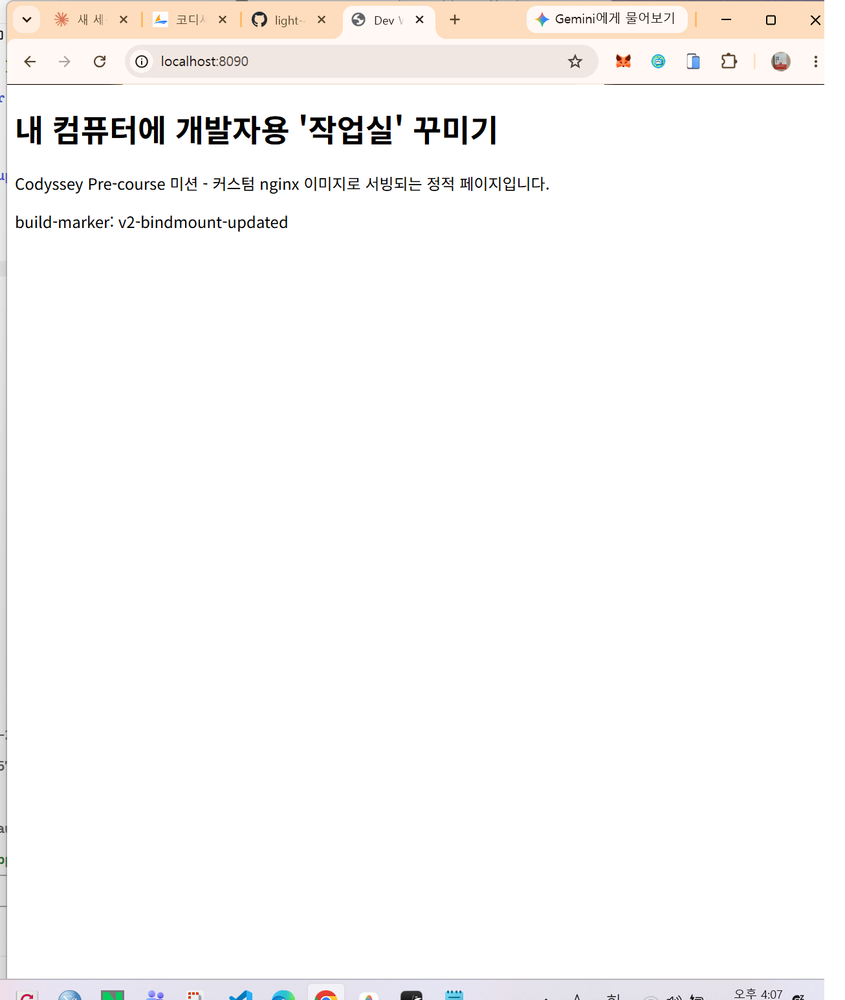
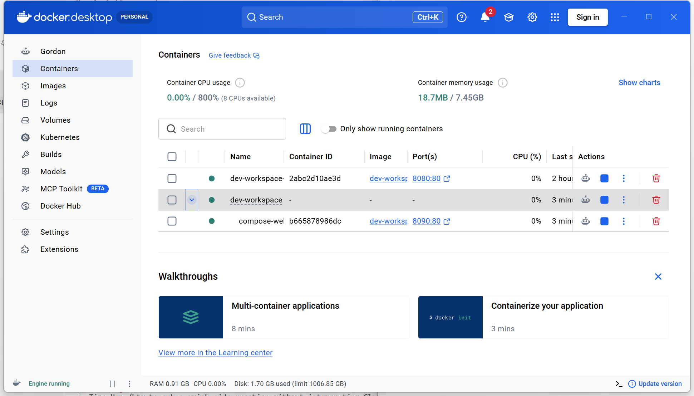
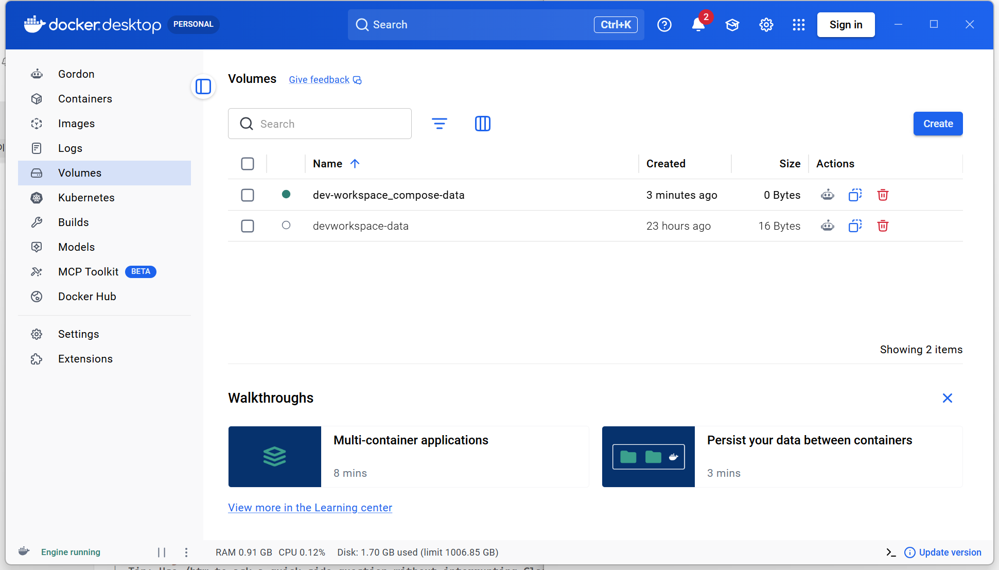

# 내 컴퓨터에 개발자용 '작업실' 꾸미기

Codyssey AI 올인원 (대전) — 입학연수 Pre-course 미션

## 1. 프로젝트 개요 (미션 목표 요약)

터미널, Docker, Git을 직접 손으로 세팅해 보면서 "개발 워크스테이션"을 구축한다.
작업 디렉토리/권한을 터미널로 정리하고, Docker를 설치·점검하여 컨테이너를 실행/관리하며,
간단한 웹 서버를 Dockerfile로 컨테이너화한다. 포트 매핑으로 접속을 확인하고,
바인드 마운트/볼륨으로 "변경 반영"과 "데이터 영속성"을 직접 검증한 뒤,
Git/GitHub으로 결과물을 버전 관리하고 제출한다.

## 2. 실행 환경

| 항목 | 값 |
|---|---|
| OS | Microsoft Windows 11 Home 10.0.22631 |
| 터미널 | Git Bash (MSYS), PowerShell |
| Docker | `Docker version 29.9.2, build a82e528` (Docker Desktop, WSL2 backend) |
| Git | `git version 2.56.0.windows.4` |

## 3. 수행 항목 체크리스트

- [x] 터미널 조작 (경로 확인/목록/이동/생성/복사/이름변경/삭제, 숨김 파일 포함)
- [x] 권한(permission) 실습 (파일 1개 + 디렉토리 1개, chmod 전/후 비교)
- [x] Docker 설치 및 기본 점검 (`docker --version`, `docker info`)
- [x] Docker 기본 운영 명령 (`images`, `ps`, `ps -a`, `logs`, `stats`, `exec`)
- [x] 컨테이너 실행 실습 (`hello-world`, `ubuntu` 진입/명령 실행)
- [x] 기존 Dockerfile(nginx:alpine) 기반 커스텀 이미지 제작
- [x] 포트 매핑 및 접속 증거 (curl)
- [x] 바인드 마운트: 호스트 변경 → 컨테이너 즉시 반영 검증
- [x] Docker 볼륨: 컨테이너 삭제 후에도 데이터 유지 검증
- [x] Git 설정 및 GitHub 연동
- [x] (보너스) Docker Compose로 멀티 서비스 선언 및 실행

## 4. 검증 방법 및 결과 (어떤 명령으로 무엇을 확인했는지)

모든 명령과 출력 전문은 저장소의 `logs_*.txt` 파일에 그대로 보존되어 있습니다.

### 4.0 프로젝트 디렉토리 구조

```text
dev-workspace/
├── README.md                 # 본 기술 문서 (전체 수행 내용 + 검증 결과 + 증거 링크)
├── Dockerfile                 # 커스텀 nginx 이미지 정의 (방식 A: 웹서버 베이스)
├── docker-compose.yml          # (보너스) 단일 서비스 Compose 선언
├── terminal_practice.sh        # 터미널 조작 실습 스크립트 (재현용)
├── app/
│   └── index.html              # 컨테이너가 서빙하는 정적 웹 페이지 (바인드 마운트 대상)
├── screenshots/                 # 포트 접속·Docker Desktop·GitHub 실제 스크린샷 (01~08)
└── logs_*.txt                   # 각 실습 단계별 "명령어 + 출력 결과" 원본 로그
    ├── logs_terminal.txt         # 4.1 터미널 조작
    ├── logs_permission.txt       # 4.2 권한 실습
    ├── logs_docker_check.txt     # 4.3 Docker 설치/점검 (요약)
    ├── logs_docker_info_full.txt # 4.3 docker info 전체 출력
    ├── logs_hello_world.txt      # 4.4 hello-world 실행 로그
    ├── logs_docker_ops.txt       # 4.4 기본 운영 명령 + 컨테이너 실행 실습
    ├── logs_cleanup.txt          # 4.4 컨테이너/이미지 정리 (docker rm/rmi)
    ├── logs_docker_build.txt     # 4.5 커스텀 이미지 빌드
    ├── logs_port_mapping.txt     # 4.6 포트 매핑 접속 증거
    ├── logs_lan_access.txt       # 4.6 LAN IP(비-localhost) 접속 테스트
    ├── logs_port_conflict.txt    # 트러블슈팅 3: 포트 충돌 진단/해결
    ├── logs_bindmount.txt        # 4.7 바인드 마운트 반영 증거
    ├── logs_volume.txt           # 4.8 볼륨 영속성 증거
    ├── logs_git_setup.txt        # 4.9 Git 설정 (git config --list)
    ├── logs_git_remote.txt       # 4.9 git remote / push 증거
    └── logs_compose.txt          # 4.10 (보너스) Docker Compose 실행 로그
```

**구성 기준**: 소스/설정(루트의 `Dockerfile`, `docker-compose.yml`, `app/`)과 증거(`logs_*.txt`, `screenshots/`)를 분리해, 코드는 코드대로 재현 가능하게 두고 각 단계의 실행 결과는 별도 로그 파일로 추적할 수 있게 구성했다.

### 4.1 터미널 조작 — [`logs_terminal.txt`](./logs_terminal.txt) ([스크립트: terminal_practice.sh](./terminal_practice.sh))

`pwd`로 현재 위치 확인 → `ls -la`로 숨김 파일 포함 목록 확인 → `mkdir -p practice`로 디렉토리 생성 →
`cd practice`로 이동 → `touch sample.txt .hidden_sample`로 빈 파일 생성 →
`echo ... > sample.txt` / `cat sample.txt`로 내용 작성·확인 → `cp`로 복사 →
`mv`로 이름변경 → `rm`으로 삭제, 각 단계마다 `ls -la`로 변화 확인.

```text
+ pwd
/c/Users/USER/Desktop/dev-workspace/practice
+ ls -la
total 0
drwxr-xr-x 1 USER 197121 0 Nov  3 16:40 .
drwxr-xr-x 1 USER 197121 0 Nov  3 16:40 ..
-rw-r--r-- 1 USER 197121 0 Nov  3 16:40 .hidden_sample
-rw-r--r-- 1 USER 197121 0 Nov  3 16:40 sample.txt
```

**절대 경로 vs 상대 경로**: `terminal_practice.sh`는 맨 처음 `cd "/c/Users/USER/Desktop/dev-workspace"`로 이동하는데, 이건 **절대 경로**(루트 `/`부터 시작해 어떤 위치에서 실행하든 항상 같은 곳을 가리킴)다. 반면 그 다음에 나오는 `cd practice`는 **상대 경로**(현재 작업 디렉토리를 기준으로 한 경로이므로, 실행 당시 위치가 다르면 결과도 달라짐)다. 예를 들어 `dev-workspace`에 있을 때 `cd practice`는 `dev-workspace/practice`로 이동하지만, 다른 디렉토리에 있을 때 같은 명령을 치면 전혀 다른 곳으로 이동하거나 "No such file or directory" 오류가 난다. 스크립트 맨 앞에서 절대 경로로 먼저 고정한 이유도 "어디서 실행해도 동일하게 동작"하게 만들기 위함이다.

### 4.2 권한 실습 — [`logs_permission.txt`](./logs_permission.txt)

Ubuntu 컨테이너(`docker run -v ...:/work -w /work ubuntu`) 내부에서 실제 리눅스 권한 체계로 검증.
파일은 `600`(rw-------) → `644`(rw-r--r--), 디렉토리는 `700`(rwx------) → `755`(rwxr-xr-x)로 변경.

```text
=== 변경 전 (before) ===
drwx------ 1 root root 4096 ... perm_dir
-rw------- 1 root root    0 ... perm_file.txt

=== 변경 후 (after) ===
drwxr-xr-x 1 root root 4096 ... perm_dir
-rw-r--r-- 1 root root    0 ... perm_file.txt

=== stat 숫자 표기 재확인 ===
-rw-r--r-- 644 perm_test/perm_file.txt
drwxr-xr-x 755 perm_test/perm_dir
```

**r/w/x 및 755·644 해석**: 권한은 `소유자/그룹/기타` 3묶음 × `읽기(r=4)/쓰기(w=2)/실행(x=1)`로 구성된다.
`644` = 소유자 rw(4+2=6), 그룹 r(4), 기타 r(4) → 파일 기본값. `755` = 소유자 rwx(4+2+1=7), 그룹 r-x(5), 기타 r-x(5) → 디렉토리는 진입(실행 비트)이 필요하므로 x가 포함된다.

**심화: 실행 권한이 실제로 필요한 경우**: `terminal_practice.sh`처럼 "직접 실행"해야 하는 파일은 x 비트가 없으면 `Permission denied`가 난다 (`chmod +x terminal_practice.sh` 필요). 반대로 디렉토리의 x 비트는 "실행"이 아니라 "그 디렉토리 안으로 진입/탐색 가능 여부"를 의미한다 — 그래서 `755`에 x가 포함되는 이유도 디렉토리를 `cd`로 드나들 수 있어야 하기 때문이다. (참고: `4000`/`2000`/`1000` 같은 setuid/setgid/sticky bit는 이번 실습 범위를 벗어나는 특수 권한이라 별도로 다루지 않았다.)

### 4.3 Docker 설치/점검 — [`logs_docker_check.txt`](./logs_docker_check.txt), [전체 출력: `logs_docker_info_full.txt`](./logs_docker_info_full.txt)

```text
Docker version 29.9.2, build a82e528
OS: Docker Desktop / Kernel: 6.18.40.1-microsoft-standard-WSL2 / Containers: 0 / Images: 2
```

`docker info` 요약 결과이며, 데몬 상세 상태(스토리지 드라이버, 플러그인, 리소스 등)를 포함한 전체 출력은 [`logs_docker_info_full.txt`](./logs_docker_info_full.txt)에 보존했다.

### 4.4 Docker 기본 운영 + 컨테이너 실행 실습 — [`logs_docker_ops.txt`](./logs_docker_ops.txt)

**hello-world 실행** — [`logs_hello_world.txt`](./logs_hello_world.txt)

```text
$ docker run --rm hello-world

Hello from Docker!
This message shows that your installation appears to be working correctly.

To generate this message, Docker took the following steps:
 1. The Docker client contacted the Docker daemon.
 2. The Docker daemon pulled the "hello-world" image from the Docker Hub.
 3. The Docker daemon created a new container from that image which runs the
    executable that produces the output you are currently reading.
 4. The Docker daemon streamed that output to the Docker client, which sent it
    to your terminal.
```

Docker 클라이언트 → 데몬 → 이미지 pull → 컨테이너 생성/실행 → 출력 스트리밍까지의 전체 흐름이 성공했음을 확인했다.

`docker run -d`로 백그라운드 컨테이너 실행 → `docker ps`로 실행 목록 확인 → `docker logs`로 로그 확인 →
`docker stats --no-stream`으로 리소스 확인 → `docker exec`로 실행 중인 컨테이너에 새 프로세스 진입 →
`docker stop` → `docker ps -a`로 중지된 컨테이너까지 전체 확인.

```text
CONTAINER ID   IMAGE     COMMAND                   STATUS         NAMES
0f5f0875c349   ubuntu    "bash -c 'while true…"   Up 3 seconds   demo-ubuntu

=== docker logs demo-ubuntu ===
tick 07:42:21
tick 07:42:23
tick 07:42:25

=== docker exec ===
exec로 들어와서 실행한 명령

=== docker ps -a (중지 후) ===
0f5f0875c349   ubuntu   Exited (137) ...   demo-ubuntu
```

**attach vs exec 차이**: `attach`는 컨테이너의 **메인 프로세스(PID 1)의 표준입출력에 그대로 연결**하는 것이라 메인 프로세스를 종료시키면 컨테이너 자체가 멈출 위험이 있다. 반면 `exec`는 이미 실행 중인 컨테이너 **안에 새로운 프로세스를 추가로 띄워서** 실행하는 방식이라 메인 프로세스와 분리되어 있고, 끝나도 컨테이너에는 영향이 없다. 위 실습에서는 `exec`로 메인 프로세스를 건드리지 않고 별도 명령만 실행했다.

**이미지(Image) vs 컨테이너(Container) 차이**: **이미지**는 "빌드" 결과물로 만들어진 **읽기 전용 템플릿**이다(레이어로 구성되고, 한 번 만들어지면 그 자체는 바뀌지 않는다 — 수정하려면 다시 빌드해서 새 이미지를 만들어야 한다). **컨테이너**는 그 이미지를 "실행"해서 만든 **쓰기 가능한 실행 인스턴스**로, 같은 이미지 하나로 컨테이너를 여러 개 동시에 띄울 수 있고(`dev-workspace-web:v1` 이미지 하나로 8080/8090/8091 포트의 서로 다른 컨테이너를 각각 띄운 것이 그 예) 컨테이너 안에서 파일을 바꿔도 이미지 자체는 전혀 영향받지 않는다. 즉 "이미지 = 불변 설계도", "컨테이너 = 그 설계도로 띄운, 상태를 가진 실행 중인 프로세스"라고 정리할 수 있다. 컨테이너를 삭제해도 이미지는 그대로 남아있고(실제로 `docker rmi`를 따로 해야 이미지가 지워짐), 반대로 컨테이너의 변경 사항은 컨테이너를 지우면 함께 사라진다(그래서 4.8의 영속 데이터는 컨테이너가 아니라 별도의 볼륨에 저장한다).

**컨테이너/이미지 정리 (docker rm / docker rmi)** — [`logs_cleanup.txt`](./logs_cleanup.txt)

```text
$ docker stop cleanup-demo
$ docker rm cleanup-demo        # 정지된 컨테이너 삭제
$ docker rmi alpine             # 더 이상 쓰지 않는 이미지 삭제
Untagged: alpine:latest
Deleted: sha256:be2656061b536c1883c4034790e21d0a09c5aaaf51968b89368a3c0371ea2c9a
```


### 4.5 커스텀 Dockerfile 이미지 (방식 A: 웹서버 베이스) — [`Dockerfile`](./Dockerfile), [`app/index.html`](./app/index.html), [`logs_docker_build.txt`](./logs_docker_build.txt)

기존 베이스: `nginx:alpine` 공식 이미지. 적용한 커스텀 포인트: `COPY app/ /usr/share/nginx/html/`로 nginx 기본 환영 페이지를 미션 전용 정적 콘텐츠로 교체.

```dockerfile
FROM nginx:alpine
COPY app/ /usr/share/nginx/html/
EXPOSE 80
```

```text
$ docker build -t dev-workspace-web:v1 .
...
#7 naming to docker.io/library/dev-workspace-web:v1 done
#7 DONE 1.3s
```

빌드 성공, 컨테이너 실행 성공 (아래 4.6 참고).

### 4.6 포트 매핑 접속 증거 — [`logs_port_mapping.txt`](./logs_port_mapping.txt)

`docker run -d -p 8080:80 dev-workspace-web:v1`로 호스트 8080 포트를 컨테이너 80 포트에 매핑.

```text
$ docker ps
0.0.0.0:8080->80/tcp   dev-workspace-web

$ curl -s http://localhost:8080
<h1>내 컴퓨터에 개발자용 '작업실' 꾸미기</h1>
<p>Codyssey Pre-course 미션 - 커스텀 nginx 이미지로 서빙되는 정적 페이지입니다.</p>
<p id="marker">build-marker: v1</p>
```


**포트 매핑(포트 포워딩)이 필요한 이유**: 컨테이너는 호스트와 분리된 **독립된 네트워크 네임스페이스**를 가진다. 즉 컨테이너 안의 `80` 포트는 기본적으로 컨테이너 내부에서만 보이고, 호스트(윈도우)나 외부에서는 직접 접근할 수 없다. `-p 8080:80`은 "호스트의 8080 포트로 들어온 트래픽을 이 컨테이너의 80 포트로 전달(포워딩)하라"는 **네트워크 네임스페이스 간의 명시적 연결 규칙**이며, Docker가 내부적으로 NAT(포트 포워딩) 규칙을 만들어 처리한다. 포트를 매핑하지 않으면 컨테이너가 정상적으로 떠 있어도 호스트에서는 `curl localhost:8080`이 "연결 거부"로 실패한다 — 애초에 호스트와 연결된 통로 자체가 없기 때문이다. 같은 이미지로 여러 컨테이너를 띄울 때 호스트 포트(8080, 8090, 8091 등)를 서로 다르게 지정해야 하는 이유도, 호스트 쪽 포트 하나는 동시에 한 프로세스만 점유할 수 있기 때문이다(아래 트러블슈팅 3 참고).

**LAN IP(비-localhost)로도 접속 테스트** — [`logs_lan_access.txt`](./logs_lan_access.txt): `-p 8080:80`은 기본적으로 `0.0.0.0:8080`에 바인딩되므로, `localhost`뿐 아니라 이 PC의 실제 네트워크 인터페이스(LAN IP)로도 접근할 수 있는지 확인했다.

```text
$ curl -s http://172.16.100.115:8090
<p id="marker">build-marker: v2-bindmount-updated</p>
=> localhost뿐 아니라 LAN IP로도 접속 가능 (같은 네트워크의 다른 기기에서도 접근 가능함을 의미)
```

### 4.7 바인드 마운트 반영 증거 — [`logs_bindmount.txt`](./logs_bindmount.txt)

`-v <호스트 app 경로>:/usr/share/nginx/html`로 바인드 마운트하여 실행한 뒤, **컨테이너 재시작/재빌드 없이** 호스트의 `app/index.html`을 수정하고 즉시 `curl`로 재확인.

```text
=== 마운트 직후 (v1) ===
<p id="marker">build-marker: v1</p>

=== 호스트 파일 수정 후, 재빌드 없이 즉시 ===
<p id="marker">build-marker: v2-bindmount-updated</p>
```

호스트 파일 변경이 컨테이너 재시작 없이 즉시 반영됨을 확인.

### 4.8 Docker 볼륨 영속성 증거 — [`logs_volume.txt`](./logs_volume.txt)

`docker volume create devworkspace-data`로 명명된 볼륨 생성 → 첫 번째 컨테이너(`--rm`, 실행 후 자동 삭제)에서 `/data/persist.txt`에 데이터 기록 → **컨테이너가 삭제된 뒤** 같은 볼륨을 연결한 **새 컨테이너**로 데이터를 다시 읽어 확인.

```text
$ docker run --rm -v devworkspace-data:/data ubuntu bash -c "echo 'persisted-hello' > /data/persist.txt && cat /data/persist.txt"
persisted-hello

$ docker run --rm -v devworkspace-data:/data ubuntu cat /data/persist.txt
persisted-hello
```

컨테이너는 매번 새로 생성/삭제됐지만 볼륨에 저장된 데이터는 그대로 유지됨을 확인.


### 4.9 Git 설정 및 GitHub 연동 — [`logs_git_setup.txt`](./logs_git_setup.txt)

```text
$ git init
Initialized empty Git repository in .../dev-workspace/.git/

$ git config --list
user.name=light-456
user.email=kt8****03@g****.com   # 개인정보 보호를 위해 마스킹
init.defaultbranch=main
...
```

GitHub 계정(`light-456`)은 `gh auth login` 디바이스 코드 플로우로 인증 완료(`gh auth status` 확인), 본 저장소는 `git remote add origin` 이후 `git push`로 GitHub에 연동한다.

**원격 연결 및 푸시 증거** — [`logs_git_remote.txt`](./logs_git_remote.txt)

```text
$ git remote -v
origin  https://github.com/light-456/dev-workspace.git (fetch)
origin  https://github.com/light-456/dev-workspace.git (push)

$ git log --oneline -5
5f50af8 feat: add bonus Docker Compose setup with evidence
ce20129 docs: add real screenshots (browser, Docker Desktop, GitHub) as visual evidence
f29a9c9 feat: dev workspace setup - terminal/permission practice, Docker custom nginx image, ...

$ git push
Everything up-to-date
```


### 4.10 (보너스) Docker Compose — [`docker-compose.yml`](./docker-compose.yml), [`logs_compose.txt`](./logs_compose.txt)

지금까지 `docker build` + `docker run -p ... -v ...`로 손으로 띄우던 웹 서버를 `docker-compose.yml` 한 파일에 선언하고, `docker compose` 명령 한 줄로 빌드·실행·확인하는 과정을 실습했다.

```yaml
name: dev-workspace

services:
  web:
    build: .
    container_name: dev-workspace-compose-web
    ports:
      - "8090:80"          # 기존 8080(수동 run)과 별도로 8090 포트 사용
    volumes:
      - ./app:/usr/share/nginx/html   # 바인드 마운트
      - compose-data:/data            # 네임드 볼륨

volumes:
  compose-data:
```

```text
$ docker compose up -d --build
 Image dev-workspace-web Built
 Network dev-workspace_default Created
 Volume dev-workspace_compose-data Created
 Container dev-workspace-compose-web Started

$ docker compose ps
NAME                        IMAGE               SERVICE   STATUS          PORTS
dev-workspace-compose-web   dev-workspace-web   web       Up              0.0.0.0:8090->80/tcp

$ curl -s localhost:8090
<p id="marker">build-marker: v2-bindmount-updated</p>

$ docker volume ls
dev-workspace_compose-data
devworkspace-data
```

**기존 `docker run` 방식과의 차이**: `docker run`으로 띄운 `dev-workspace-web-bind`(8080 포트)는 그대로 두고, `docker compose up` 한 번으로 완전히 별도의 서비스(`dev-workspace-compose-web`, 8090 포트)를 빌드부터 네트워크·볼륨 생성까지 전부 자동으로 처리했다. Docker Desktop의 Containers 목록에서도 `dev-workspace`라는 **compose 프로젝트 그룹**으로 묶여서 보이며, 그 안에 `web` 서비스 컨테이너가 속해 있는 구조를 확인할 수 있다.





## 5. 트러블슈팅

### 트러블슈팅 1
- **문제**: Git Bash(MSYS)에서 `docker run -v "C:\...\dev-workspace:/work" -w /work ubuntu ...` 실행 시 `the working directory 'C:/Program Files/Git/work' is invalid` 오류 발생.
- **원인 가설**: MSYS/Git Bash가 `/work`처럼 `/`로 시작하는 인자를 "유닉스 절대경로"로 오인하여 자동으로 Windows 경로로 변환(path conversion)하기 때문.
- **확인**: 동일 명령에 `MSYS_NO_PATHCONV=1` 환경변수를 붙여 재실행하니 정상 동작.
- **해결/대안**: Docker 컨테이너 내부 경로(`/work`, `/data` 등)가 포함된 `docker run` 명령은 항상 `MSYS_NO_PATHCONV=1 docker run ...` 형태로 실행하도록 통일.
- **참고(윈도우 절대경로 표기)**: 반대로 "호스트 쪽" 경로는 Windows 절대경로(`C:\Users\USER\Desktop\dev-workspace`)를 그대로 써야 하며, Git Bash에서는 이를 `/c/Users/USER/Desktop/dev-workspace` 형태로 바꿔 써도 동일하게 동작한다(둘 다 같은 위치를 가리키는 절대경로 표기법 차이일 뿐이다). 예: `docker run -v "/c/Users/USER/Desktop/dev-workspace/app:/usr/share/nginx/html" ...`.

### 트러블슈팅 2
- **문제**: 권한(permission) 실습에서 `chmod 644`/`755` 적용 전/후 `ls -l` 결과가 동일하게 나와 "변경"을 증명하지 못함.
- **원인 가설**: `mkdir`/`touch`로 새로 만든 파일·디렉토리의 기본(umask) 권한이 우연히 목표 값(644/755)과 같았기 때문.
- **확인**: 먼저 `chmod 600`(파일) / `chmod 700`(디렉토리)으로 의도적으로 다른 값을 설정한 뒤 `ls -l`로 전 상태를 캡처하고, 다시 644/755로 변경하여 비교.
- **해결/대안**: 이후 "before/after" 비교가 필요한 모든 실습은 먼저 기준값과 다른 초기 상태를 명시적으로 만들어 두고 시작하도록 함.

### 트러블슈팅 3 — [`logs_port_conflict.txt`](./logs_port_conflict.txt)
- **문제**: 이미 8090 포트를 쓰고 있는 `dev-workspace-compose-web` 컨테이너가 떠 있는 상태에서 같은 8090 포트로 새 컨테이너를 띄우려 하면 `Bind for 0.0.0.0:8090 failed: port is already allocated` 오류 발생.
- **원인 가설**: 호스트 포트는 한 시점에 하나의 프로세스(여기서는 Docker의 포트 포워딩 프록시)만 점유할 수 있는데, 이미 다른 컨테이너가 그 포트를 선점하고 있기 때문.
- **확인(진단 절차)**: `netstat -ano | grep ":8090"`으로 해당 포트를 점유 중인 프로세스(PID)를 먼저 확인하고, `docker ps --filter "publish=8090"`으로 그 포트를 쓰고 있는 컨테이너를 교차 확인하여 `dev-workspace-compose-web`이 원인임을 특정.
- **해결/대안**: (A) 충돌난 새 컨테이너는 정리(`docker rm -f`)하고 사용하지 않는 다른 포트(예: 8091)로 재시도, 또는 (B) 기존 점유 컨테이너를 `docker stop`한 뒤 포트를 재사용. 본 실습에서는 (A) 방식으로 8091 포트에 재시도하여 정상 기동과 `curl` 200 응답을 확인했다.

```text
$ docker run -d --name port-conflict-test -p 8090:80 nginx:alpine
docker: Error response from daemon: ... Bind for 0.0.0.0:8090 failed: port is already allocated

$ netstat -ano | grep ":8090" | grep LISTENING
TCP    0.0.0.0:8090    0.0.0.0:0    LISTENING    7880

$ docker ps --filter "publish=8090"
dev-workspace-compose-web   0.0.0.0:8090->80/tcp

$ docker rm -f port-conflict-test
$ docker run -d --name port-conflict-test -p 8091:80 nginx:alpine
$ curl -s -o /dev/null -w "HTTP %{http_code}\n" http://localhost:8091
HTTP 200
```

## 6. 보안 및 개인정보 보호

- 본 문서와 로그에는 토큰/비밀번호/인증 코드가 포함되지 않도록 확인했습니다.
- GitHub 인증은 `gh auth login`의 OAuth 디바이스 코드 플로우로 처리했으며, 코드/토큰 값은 기록하지 않았습니다.
- `git config --list` 결과에 포함된 이메일 주소는 README/로그에 노출되기 전 마스킹 처리했습니다 (`kt8****03@g****.com`). 단, Git/GitHub 특성상 각 커밋의 작성자(author) 메타데이터에는 실제 이메일이 그대로 남아 있으며, 이는 공개 저장소에 커밋을 푸시하면 항상 공개되는 정보로 이 문서 작성만으로는 가릴 수 없습니다. 더 가리고 싶다면 GitHub의 "noreply" 이메일로 커밋 작성자 설정을 변경하는 방법이 있습니다.
