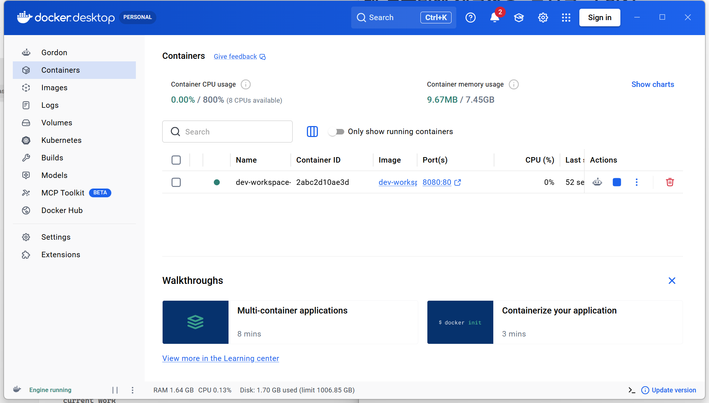
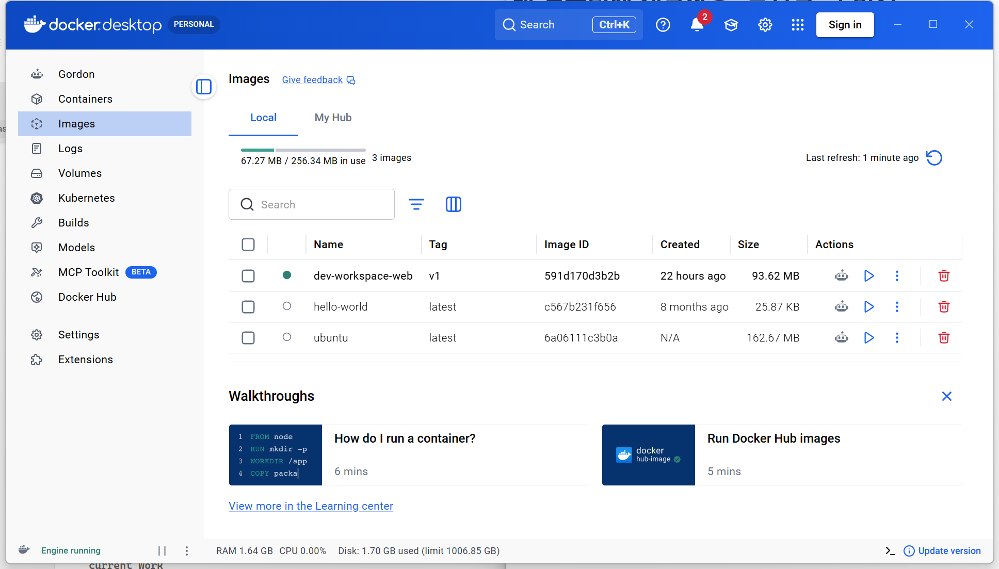
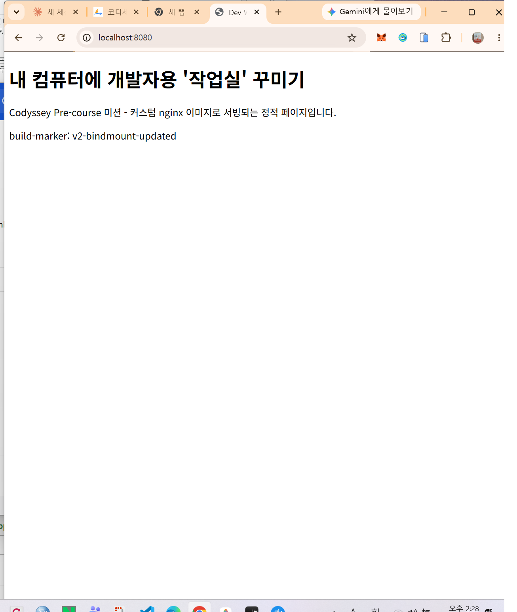
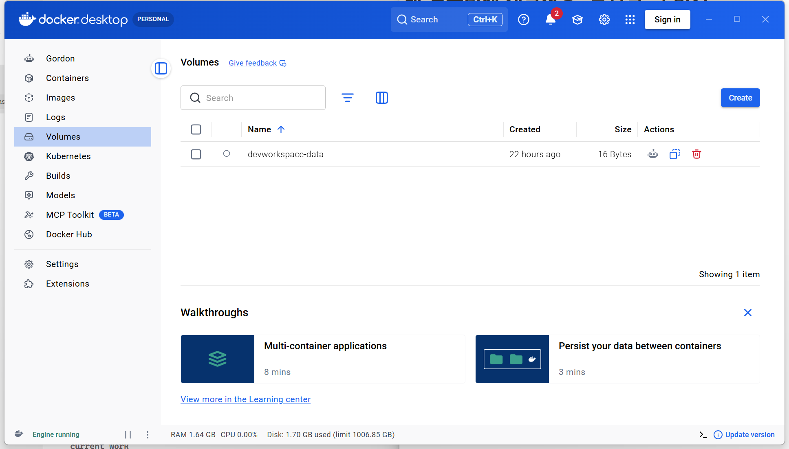
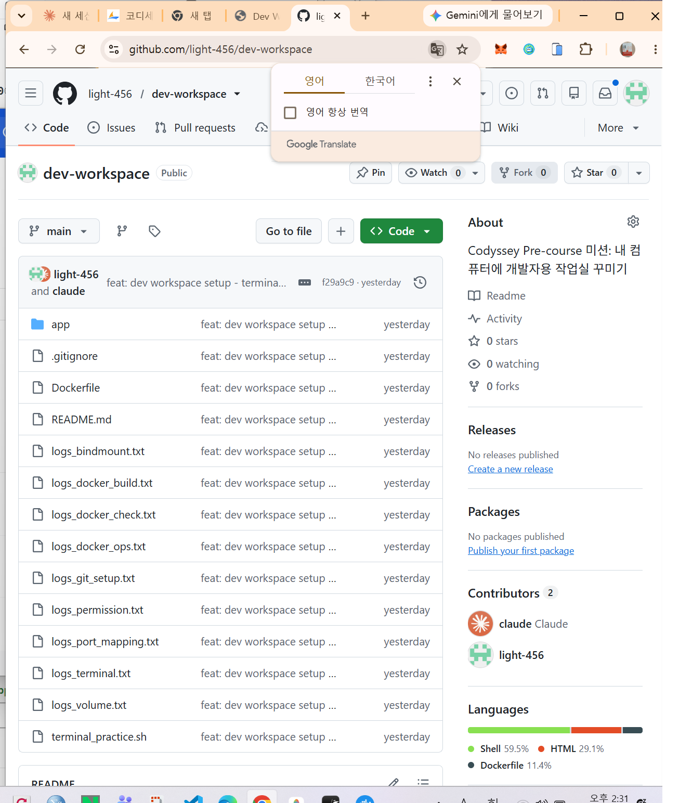

# 내 컴퓨터에 개발자용 '작업실' 꾸미기

Codyssey AI 올인원 (대전) — 입학연수 Pre-course 미션

## 1. 프로젝트 개요 (미션 목표 요약)

터미널, Docker, Git을 직접 손으로 세팅해 보면서 "개발 워크스테이션"을 구축한다.
작업 디렉토리/권한을 터미널로 정리하고, Docker를 설치·점검하여 컨테이너를 실행/관리하며,
간단한 웹 서버를 Dockerfile로 컨테이너화한다. 포트 매핑으로 접속을 확인하고,
바인드 마운트/볼륨으로 "변경 반영"과 "데이터 영속성"을 직접 검증한 뒤,
Git/GitHub으로 결과물을 버전 관리하고 제출한다.

## 2. 실행 환경

| 항목 | 값 |
|---|---|
| OS | Microsoft Windows 11 Home 10.0.22631 |
| 터미널 | Git Bash (MSYS), PowerShell |
| Docker | `Docker version 29.9.2, build a82e528` (Docker Desktop, WSL2 backend) |
| Git | `git version 2.56.0.windows.4` |

## 3. 수행 항목 체크리스트

- [x] 터미널 조작 (경로 확인/목록/이동/생성/복사/이름변경/삭제, 숨김 파일 포함)
- [x] 권한(permission) 실습 (파일 1개 + 디렉토리 1개, chmod 전/후 비교)
- [x] Docker 설치 및 기본 점검 (`docker --version`, `docker info`)
- [x] Docker 기본 운영 명령 (`images`, `ps`, `ps -a`, `logs`, `stats`, `exec`)
- [x] 컨테이너 실행 실습 (`hello-world`, `ubuntu` 진입/명령 실행)
- [x] 기존 Dockerfile(nginx:alpine) 기반 커스텀 이미지 제작
- [x] 포트 매핑 및 접속 증거 (curl)
- [x] 바인드 마운트: 호스트 변경 → 컨테이너 즉시 반영 검증
- [x] Docker 볼륨: 컨테이너 삭제 후에도 데이터 유지 검증
- [x] Git 설정 및 GitHub 연동

## 4. 검증 방법 및 결과 (어떤 명령으로 무엇을 확인했는지)

모든 명령과 출력 전문은 저장소의 `logs_*.txt` 파일에 그대로 보존되어 있습니다.

### 4.1 터미널 조작 — [`logs_terminal.txt`](./logs_terminal.txt) ([스크립트: terminal_practice.sh](./terminal_practice.sh))

`pwd`로 현재 위치 확인 → `ls -la`로 숨김 파일 포함 목록 확인 → `mkdir -p practice`로 디렉토리 생성 →
`cd practice`로 이동 → `touch sample.txt .hidden_sample`로 빈 파일 생성 →
`echo ... > sample.txt` / `cat sample.txt`로 내용 작성·확인 → `cp`로 복사 →
`mv`로 이름변경 → `rm`으로 삭제, 각 단계마다 `ls -la`로 변화 확인.

```text
+ pwd
/c/Users/USER/Desktop/dev-workspace/practice
+ ls -la
total 0
drwxr-xr-x 1 USER 197121 0 Nov  3 16:40 .
drwxr-xr-x 1 USER 197121 0 Nov  3 16:40 ..
-rw-r--r-- 1 USER 197121 0 Nov  3 16:40 .hidden_sample
-rw-r--r-- 1 USER 197121 0 Nov  3 16:40 sample.txt
```

### 4.2 권한 실습 — [`logs_permission.txt`](./logs_permission.txt)

Ubuntu 컨테이너(`docker run -v ...:/work -w /work ubuntu`) 내부에서 실제 리눅스 권한 체계로 검증.
파일은 `600`(rw-------) → `644`(rw-r--r--), 디렉토리는 `700`(rwx------) → `755`(rwxr-xr-x)로 변경.

```text
=== 변경 전 (before) ===
drwx------ 1 root root 4096 ... perm_dir
-rw------- 1 root root    0 ... perm_file.txt

=== 변경 후 (after) ===
drwxr-xr-x 1 root root 4096 ... perm_dir
-rw-r--r-- 1 root root    0 ... perm_file.txt

=== stat 숫자 표기 재확인 ===
-rw-r--r-- 644 perm_test/perm_file.txt
drwxr-xr-x 755 perm_test/perm_dir
```

**r/w/x 및 755·644 해석**: 권한은 `소유자/그룹/기타` 3묶음 × `읽기(r=4)/쓰기(w=2)/실행(x=1)`로 구성된다.
`644` = 소유자 rw(4+2=6), 그룹 r(4), 기타 r(4) → 파일 기본값. `755` = 소유자 rwx(4+2+1=7), 그룹 r-x(5), 기타 r-x(5) → 디렉토리는 진입(실행 비트)이 필요하므로 x가 포함된다.

### 4.3 Docker 설치/점검 — [`logs_docker_check.txt`](./logs_docker_check.txt)

```text
Docker version 29.9.2, build a82e528
OS: Docker Desktop / Kernel: 6.18.40.1-microsoft-standard-WSL2 / Containers: 0 / Images: 2
```

### 4.4 Docker 기본 운영 + 컨테이너 실행 실습 — [`logs_docker_ops.txt`](./logs_docker_ops.txt)

`docker run -d`로 백그라운드 컨테이너 실행 → `docker ps`로 실행 목록 확인 → `docker logs`로 로그 확인 →
`docker stats --no-stream`으로 리소스 확인 → `docker exec`로 실행 중인 컨테이너에 새 프로세스 진입 →
`docker stop` → `docker ps -a`로 중지된 컨테이너까지 전체 확인.

```text
CONTAINER ID   IMAGE     COMMAND                   STATUS         NAMES
0f5f0875c349   ubuntu    "bash -c 'while true…"   Up 3 seconds   demo-ubuntu

=== docker logs demo-ubuntu ===
tick 07:42:21
tick 07:42:23
tick 07:42:25

=== docker exec ===
exec로 들어와서 실행한 명령

=== docker ps -a (중지 후) ===
0f5f0875c349   ubuntu   Exited (137) ...   demo-ubuntu
```

**attach vs exec 차이**: `attach`는 컨테이너의 **메인 프로세스(PID 1)의 표준입출력에 그대로 연결**하는 것이라 메인 프로세스를 종료시키면 컨테이너 자체가 멈출 위험이 있다. 반면 `exec`는 이미 실행 중인 컨테이너 **안에 새로운 프로세스를 추가로 띄워서** 실행하는 방식이라 메인 프로세스와 분리되어 있고, 끝나도 컨테이너에는 영향이 없다. 위 실습에서는 `exec`로 메인 프로세스를 건드리지 않고 별도 명령만 실행했다.




### 4.5 커스텀 Dockerfile 이미지 (방식 A: 웹서버 베이스) — [`Dockerfile`](./Dockerfile), [`app/index.html`](./app/index.html), [`logs_docker_build.txt`](./logs_docker_build.txt)

기존 베이스: `nginx:alpine` 공식 이미지. 적용한 커스텀 포인트: `COPY app/ /usr/share/nginx/html/`로 nginx 기본 환영 페이지를 미션 전용 정적 콘텐츠로 교체.

```dockerfile
FROM nginx:alpine
COPY app/ /usr/share/nginx/html/
EXPOSE 80
```

```text
$ docker build -t dev-workspace-web:v1 .
...
#7 naming to docker.io/library/dev-workspace-web:v1 done
#7 DONE 1.3s
```

빌드 성공, 컨테이너 실행 성공 (아래 4.6 참고).

### 4.6 포트 매핑 접속 증거 — [`logs_port_mapping.txt`](./logs_port_mapping.txt)

`docker run -d -p 8080:80 dev-workspace-web:v1`로 호스트 8080 포트를 컨테이너 80 포트에 매핑.

```text
$ docker ps
0.0.0.0:8080->80/tcp   dev-workspace-web

$ curl -s http://localhost:8080
<h1>내 컴퓨터에 개발자용 '작업실' 꾸미기</h1>
<p>Codyssey Pre-course 미션 - 커스텀 nginx 이미지로 서빙되는 정적 페이지입니다.</p>
<p id="marker">build-marker: v1</p>
```



### 4.7 바인드 마운트 반영 증거 — [`logs_bindmount.txt`](./logs_bindmount.txt)

`-v <호스트 app 경로>:/usr/share/nginx/html`로 바인드 마운트하여 실행한 뒤, **컨테이너 재시작/재빌드 없이** 호스트의 `app/index.html`을 수정하고 즉시 `curl`로 재확인.

```text
=== 마운트 직후 (v1) ===
<p id="marker">build-marker: v1</p>

=== 호스트 파일 수정 후, 재빌드 없이 즉시 ===
<p id="marker">build-marker: v2-bindmount-updated</p>
```

호스트 파일 변경이 컨테이너 재시작 없이 즉시 반영됨을 확인.

### 4.8 Docker 볼륨 영속성 증거 — [`logs_volume.txt`](./logs_volume.txt)

`docker volume create devworkspace-data`로 명명된 볼륨 생성 → 첫 번째 컨테이너(`--rm`, 실행 후 자동 삭제)에서 `/data/persist.txt`에 데이터 기록 → **컨테이너가 삭제된 뒤** 같은 볼륨을 연결한 **새 컨테이너**로 데이터를 다시 읽어 확인.

```text
$ docker run --rm -v devworkspace-data:/data ubuntu bash -c "echo 'persisted-hello' > /data/persist.txt && cat /data/persist.txt"
persisted-hello

$ docker run --rm -v devworkspace-data:/data ubuntu cat /data/persist.txt
persisted-hello
```

컨테이너는 매번 새로 생성/삭제됐지만 볼륨에 저장된 데이터는 그대로 유지됨을 확인.



### 4.9 Git 설정 및 GitHub 연동 — [`logs_git_setup.txt`](./logs_git_setup.txt)

```text
$ git init
Initialized empty Git repository in .../dev-workspace/.git/

$ git config --list
user.name=light-456
user.email=kt88206603@gmail.com
init.defaultbranch=main
...
```

GitHub 계정(`light-456`)은 `gh auth login` 디바이스 코드 플로우로 인증 완료(`gh auth status` 확인), 본 저장소는 `git remote add origin` 이후 `git push`로 GitHub에 연동한다.



## 5. 트러블슈팅

### 트러블슈팅 1
- **문제**: Git Bash(MSYS)에서 `docker run -v "C:\...\dev-workspace:/work" -w /work ubuntu ...` 실행 시 `the working directory 'C:/Program Files/Git/work' is invalid` 오류 발생.
- **원인 가설**: MSYS/Git Bash가 `/work`처럼 `/`로 시작하는 인자를 "유닉스 절대경로"로 오인하여 자동으로 Windows 경로로 변환(path conversion)하기 때문.
- **확인**: 동일 명령에 `MSYS_NO_PATHCONV=1` 환경변수를 붙여 재실행하니 정상 동작.
- **해결/대안**: Docker 컨테이너 내부 경로(`/work`, `/data` 등)가 포함된 `docker run` 명령은 항상 `MSYS_NO_PATHCONV=1 docker run ...` 형태로 실행하도록 통일.

### 트러블슈팅 2
- **문제**: 권한(permission) 실습에서 `chmod 644`/`755` 적용 전/후 `ls -l` 결과가 동일하게 나와 "변경"을 증명하지 못함.
- **원인 가설**: `mkdir`/`touch`로 새로 만든 파일·디렉토리의 기본(umask) 권한이 우연히 목표 값(644/755)과 같았기 때문.
- **확인**: 먼저 `chmod 600`(파일) / `chmod 700`(디렉토리)으로 의도적으로 다른 값을 설정한 뒤 `ls -l`로 전 상태를 캡처하고, 다시 644/755로 변경하여 비교.
- **해결/대안**: 이후 "before/after" 비교가 필요한 모든 실습은 먼저 기준값과 다른 초기 상태를 명시적으로 만들어 두고 시작하도록 함.

## 6. 보안 및 개인정보 보호

- 본 문서와 로그에는 토큰/비밀번호/인증 코드가 포함되지 않도록 확인했습니다.
- GitHub 인증은 `gh auth login`의 OAuth 디바이스 코드 플로우로 처리했으며, 코드/토큰 값은 기록하지 않았습니다.
